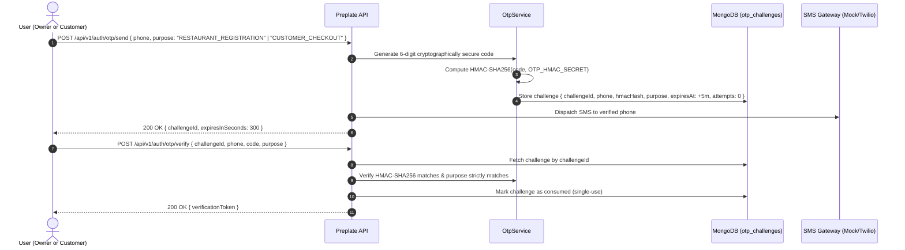
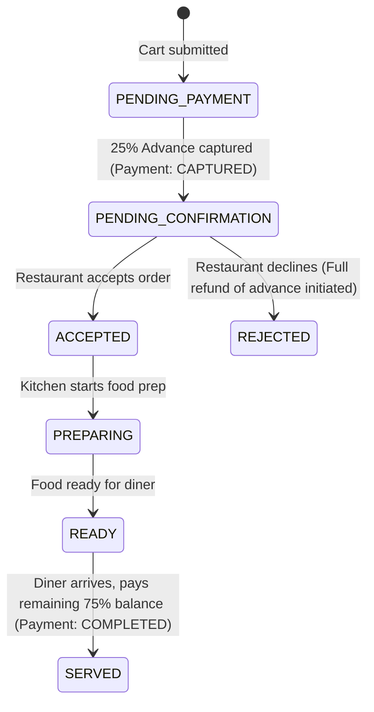

# Preplate — System Architecture & Multi-Tenant Blueprint

**Version:** 1.0.0-PROD  
**Pattern:** Modular Multi-Tenant Monolith with Tenant Partitioning  
**Backend:** Node.js 22, Express 4.21, TypeScript 5.7, MongoDB 7.0  
**Frontend:** React 18.3, Vite 6.4, Tailwind CSS 3.4  

---

## 1. High-Level System Architecture

Preplate is architected as a **Modular Multi-Tenant Monolith** to maximize transactional consistency, eliminate distributed network latency, and simplify operational maintenance for independent restaurant operators.

```
┌──────────────────────────────────────────────────────────────────────────┐
│                         CLIENT TIER (React 18 SPA)                       │
│  ┌───────────────────────┐ ┌──────────────────────┐ ┌──────────────────┐  │
│  │   Public Storefront   │ │ Restaurant Dashboard │ │ SaaS Super Admin │  │
│  │  • Menu browsing      │ │ • Live Order KDS     │ │ • Tenant onboard │  │
│  │  • Persistent cart    │ │ • Menu & Portion 86  │ │ • Plan pricing   │  │
│  │  • OTP verification   │ │ • WhatsApp alerts    │ │ • Global GMV     │  │
│  │  • 25% Advance pay    │ │ • Staff management   │ │ • Audit logs     │  │
│  └───────────────────────┘ └──────────────────────┘ └──────────────────┘  │
└────────────────────────────────────┬─────────────────────────────────────┘
                                     │ HTTPS / JSON REST API
┌────────────────────────────────────▼─────────────────────────────────────┐
│                       APPLICATION TIER (Express API)                     │
│                                                                          │
│  ┌────────────────────────────────────────────────────────────────────┐  │
│  │ Global Middleware: Correlation ID, Helmet, CORS, Body Parser, Rate │  │
│  └─────────────────────────────────┬──────────────────────────────────┘  │
│                                    │                                     │
│  ┌─────────────────────────────────▼──────────────────────────────────┐  │
│  │ Routing & Security Context:                                        │  │
│  │ • /api/v1/public        • /api/v1/auth (JWT & OTP)                 │  │
│  │ • /api/v1/restaurant    • /api/v1/super (Platform RBAC)            │  │
│  │ • enforceTenantContext  • Centralized Error Handler                │  │
│  └─────────────────────────────────┬──────────────────────────────────┘  │
│                                    │                                     │
│  ┌─────────────────────────────────▼──────────────────────────────────┐  │
│  │ Domain Services:                                                   │  │
│  │ • OtpService (HMAC hashing)      • PaymentService (25% Advance)    │  │
│  │ • OrderEngine (Price snapshot)   • NotificationService (WhatsApp)  │  │
│  └─────────────────────────────────┬──────────────────────────────────┘  │
└────────────────────────────────────┼─────────────────────────────────────┘
                                     │ Mongoose ODM
┌────────────────────────────────────▼─────────────────────────────────────┐
│                        DATA TIER (MongoDB 7.0)                           │
│  • restaurants        • users             • categories    • menu_items   │
│  • orders             • payments          • otp_challenges               │
│  • idempotency_keys   • notification_logs • audit_logs    • subscriptions│
└──────────────────────────────────────────────────────────────────────────┘
```

---

## 2. Multi-Tenant Isolation Strategy

Preplate employs a **Shared Database, Shared Schema with Compound Tenant Indexing** model.

### Rules of Tenant Isolation:
1. **Zero Client Trust:** The backend never extracts or accepts `tenantId` from client request bodies or query parameters.
2. **JWT-Derived Context:** Authenticated requests parse the verified cryptographic JWT bearer token to extract `req.user.tenantId`.
3. **Public Route Slug Binding:** Public customer routes (`/api/v1/public/restaurants/:slug/...`) look up the restaurant document by indexed `slug` and bind subsequent database operations strictly to the matched `tenantId`.
4. **Header Spoofing Traps:** Any inbound request carrying conflicting `x-tenant-id` headers is immediately rejected with HTTP 403 Forbidden and logged to `AuditLog`.
5. **Database Compound Indexes:** Every tenant collection begins its index with `{ tenantId: 1, ... }`.

---

## 3. Two Independent OTP Verification Flows

OTP (One-Time Password) confirms cryptographic control over a phone number. Preplate strictly isolates customer verification from restaurant owner authentication:



### Security Properties of OTP Subsystem:
- **HMAC Keyed Hashing:** Plaintext OTP codes are never stored in the database.
- **Strict Purpose Isolation:** A challenge issued for `CUSTOMER_CHECKOUT` cannot be submitted for `RESTAURANT_REGISTRATION`, and vice versa.
- **Throttling & Cooldown:** 60-second cooldown between resends, maximum 5 invalid attempts per challenge before revocation.
- **Zero Plaintext Logging:** OTP codes are masked in all server logs and error outputs.

---

## 4. Minimum 25% Advance Payment Engine

To prevent food wastage from no-show diners who abandon orders, Preplate enforces an authoritative minimum advance policy:

### Mathematical Formulation:
$$\text{Subtotal} = \sum (\text{item.price} \times \text{quantity})$$
$$\text{Tax (GST 5\%)} = \text{round}(\text{Subtotal} \times 0.05)$$
$$\text{Total Amount} = \text{Subtotal} + \text{Tax}$$
$$\text{Required Advance} = \left\lceil \text{Total Amount} \times \frac{\text{Advance Percent}}{100} \right\rceil \quad (\text{default: } 25\%)$$
$$\text{Remaining Balance} = \text{Total Amount} - \text{Required Advance}$$

### Independent State Machines:
- **Order State Machine:** `PENDING_PAYMENT` -> `PENDING_RESTAURANT_CONFIRMATION` -> `ACCEPTED` -> `PREPARING` -> `READY` -> `SERVED`.
- **Payment State Machine:** `PENDING` -> `AUTHORIZED` -> `CAPTURED` -> `FAILED` -> `REFUND_PENDING` -> `REFUNDED`.



---

## 5. Persistent Cart & Server Revalidation Flow

1. **Client-Side Persistence:** Guest carts are stored in browser `localStorage` keyed by restaurant slug (`preplate_cart_${slug}`), preserving items, quantities, and chosen arrival time across page refreshes.
2. **Server-Side Checkout Revalidation:**
   - Client sends only `{ menuItemId, quantity }` pairs and `expectedArrivalTime`.
   - Server re-queries live menu items from MongoDB.
   - Server validates restaurant operating hours and preparation buffer (`orderBufferMinutes`).
   - Server checks portion inventory limits (`availableQuantity`).
   - Server computes authoritative subtotal, 5% GST, total, 25% advance, and remaining balance.
   - If cart is valid, server issues order reference and payment session.

---

## 6. End-to-End Tracing & Observability

- **Correlation ID:** Every inbound request is assigned a UUID `x-request-id` via [`correlationIdMiddleware`](file:///c:/Restaurant/server/src/middleware/requestId.ts).
- **Log Propagation:** Morgan HTTP logger and error handler attach `x-request-id` to console logs and API responses.
- **Audit Logging:** Critical business actions (status advance, rejection, refund, tenant configuration) write immutable entries to `AuditLog`.
