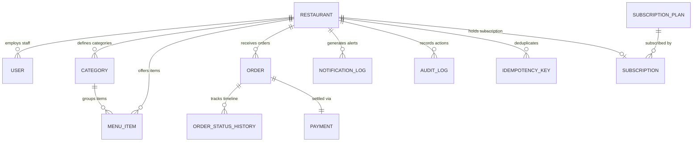
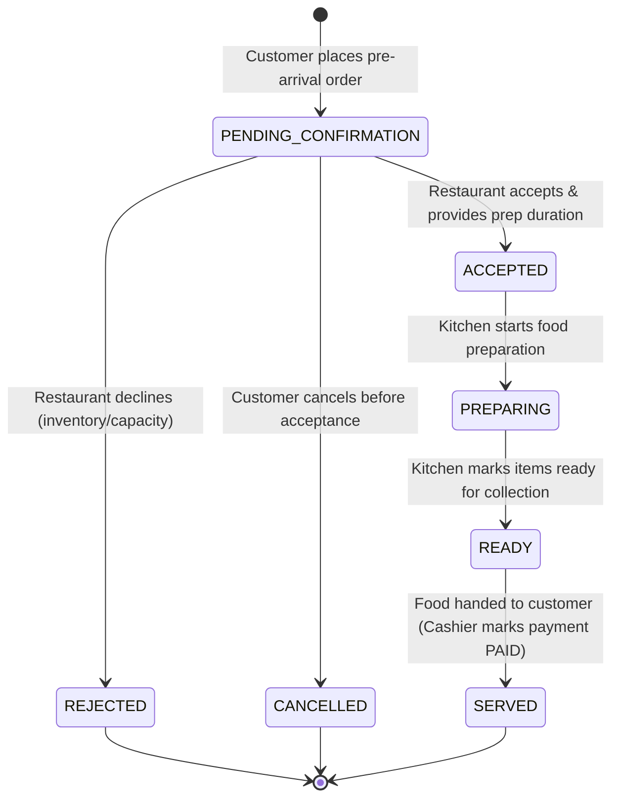
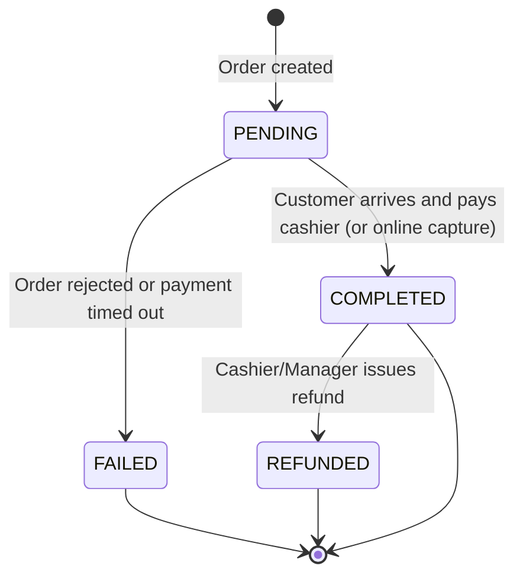

# Preplate — Multi-Tenant Database Architecture & Data Design

**Version:** 1.0.0-PROD  
**Database Technology:** MongoDB 7.0 (Mongoose 8.9 ODM)  
**Architecture Pattern:** Shared Database, Multi-Tenant Partitioning by `tenantId`  

---

## 1. Architectural Overview & Tenant Isolation Strategy

Preplate employs a **shared database, tenant-partitioned collection model**. Every business entity belongs to a single restaurant tenant identified by a unique `tenantId` string (e.g., `tenant_highway_dhaba_001`).

### Principles of Isolation:
1. **Compulsory Tenant Keying:** Every query executed on behalf of a restaurant user must include `{ tenantId: req.tenantId }`.
2. **Compound Index Optimization:** All tenant-scoped collections are backed by compound indexes beginning with `tenantId: 1`.
3. **Immutable Snapshots:** Orders snapshot line-item names and unit prices at time of creation, preventing subsequent menu modifications from altering historical orders.
4. **Independent Payment Records:** Payment attempts, transaction references, and settlement statuses are tracked in a dedicated `payments` collection.

---

## 2. Entity Relationship Diagram (ERD)

---

## 3. Core Collection Schemas & Indexing Specifications

### 3.1. `restaurants` Collection
Represents a distinct restaurant tenant in the multi-tenant SaaS.

| Field Name | Type | Constraints | Description |
| :--- | :--- | :--- | :--- |
| `_id` | ObjectId | Auto-generated PK | MongoDB internal document identifier |
| `tenantId` | String | Unique, Indexed, Trim | Alphanumeric unique tenant identifier |
| `name` | String | Required, Trim | Registered restaurant business name |
| `slug` | String | Unique, Indexed, Lowercase | URL-friendly public identifier (`/r/:slug`) |
| `tagline` | String | Optional, Trim | Marketing slogan displayed on storefront |
| `contactPhone` | String | Required, Trim | Official contact phone number |
| `whatsappNumber` | String | Required, Trim | Number used for WhatsApp order alerts |
| `address` | Subdocument | Required | Street, city, state, and postal code |
| `operatingHours` | Array | Required (7 days) | `dayOfWeek` (0-6), `openTime`, `closeTime`, `isOpen` |
| `settings` | Subdocument | Required | `orderBufferMinutes`, `minimumOrderAmount`, `currency` |
| `status` | Enum | `PENDING_APPROVAL`, `ACTIVE`, `SUSPENDED` | Account operational lifecycle state |
| `subscriptionId` | ObjectId | Ref: `Subscription` | Current active SaaS plan assignment |

**Indexes:**
- `{ tenantId: 1 }` (Unique)
- `{ slug: 1 }` (Unique)
- `{ status: 1 }`

---

### 3.2. `users` Collection
Stores platform super administrators, restaurant owners, and restaurant staff.

| Field Name | Type | Constraints | Description |
| :--- | :--- | :--- | :--- |
| `_id` | ObjectId | Auto-generated PK | User record identifier |
| `tenantId` | String | Nullable, Indexed | Tenant binding (`null` for Platform Super Admins) |
| `name` | String | Required, Trim | User's full name |
| `email` | String | Required, Unique, Lowercase | Unique login identifier |
| `passwordHash` | String | Required | 12-round bcrypt password hash |
| `role` | Enum | `SUPER_ADMIN`, `RESTAURANT_OWNER`, `RESTAURANT_STAFF`, `KITCHEN_STAFF` | Role-based permission level |
| `status` | Enum | `ACTIVE`, `INACTIVE` | Account state |

**Indexes:**
- `{ email: 1 }` (Unique)
- `{ tenantId: 1, role: 1 }`

---

### 3.3. `categories` Collection
Menu categories scoped strictly per restaurant tenant.

| Field Name | Type | Constraints | Description |
| :--- | :--- | :--- | :--- |
| `_id` | ObjectId | Auto-generated PK | Category record identifier |
| `tenantId` | String | Required, Indexed | Tenant owner |
| `name` | String | Required, Trim | Category title (e.g., "Tandoori Starters") |
| `sortOrder` | Number | Default: 0 | Display sequence on storefront |
| `isActive` | Boolean | Default: true | Visibility flag |

**Indexes:**
- `{ tenantId: 1, sortOrder: 1 }`
- `{ tenantId: 1, name: 1 }` (Unique)

---

### 3.4. `menu_items` Collection
Food items with real-time portion limits and inventory tracking.

| Field Name | Type | Constraints | Description |
| :--- | :--- | :--- | :--- |
| `_id` | ObjectId | Auto-generated PK | Item identifier |
| `tenantId` | String | Required, Indexed | Tenant owner |
| `categoryId` | ObjectId | Required, Ref: `Category` | Parent category reference |
| `name` | String | Required, Trim | Item title |
| `description` | String | Optional, Trim | Ingredients and preparation details |
| `price` | Number | Required, Min: 0 | Unit price in smallest currency unit / INR |
| `foodType` | Enum | `VEG`, `NON_VEG`, `VEGAN` | Dietary classification |
| `isAvailable` | Boolean | Default: true | Global 86/availability toggle |
| `trackInventory` | Boolean | Default: false | Enables portion decrement logic |
| `dailyStockLimit` | Number | Default: 0 | Configured daily maximum portions |
| `availableQuantity` | Number | Default: 0 | Current remaining portion count in kitchen |
| `ordersCountToday` | Number | Default: 0 | Portions sold in current service window |

**Indexes:**
- `{ tenantId: 1, categoryId: 1 }`
- `{ tenantId: 1, isAvailable: 1 }`

---

### 3.5. `orders` Collection
Customer pre-arrival orders containing immutable line-item snapshots and pricing.

| Field Name | Type | Constraints | Description |
| :--- | :--- | :--- | :--- |
| `_id` | ObjectId | Auto-generated PK | Order identifier |
| `orderReference` | String | Required, Unique, Indexed | Human-readable code (`ORD-YYYYMMDD-XXXX`) |
| `tenantId` | String | Required, Indexed | Restaurant tenant owner |
| `customer` | Subdocument | Required | `name`, `phone`, `specialInstructions` |
| `items` | Array | Required | Line items with `nameSnapshot`, `priceSnapshot`, `subtotal` |
| `pricing` | Subdocument | Required | `subtotal`, `taxAmount` (5% GST), `totalAmount` |
| `scheduling` | Subdocument | Required | `expectedArrivalTime`, `acceptedAt`, `estimatedReadyTime`, `servedAt` |
| `status` | Enum | See State Machine Below | Progressive order fulfillment status |
| `rejectionReason` | String | Optional | Specified when restaurant declines order |
| `cancellationReason` | String | Optional | Specified when customer cancels order |
| `payment` | Subdocument | Required | Embedded fast snapshot of payment state |

**Indexes:**
- `{ orderReference: 1 }` (Unique)
- `{ tenantId: 1, status: 1, createdAt: -1 }`
- `{ tenantId: 1, 'scheduling.expectedArrivalTime': 1 }`

---

### 3.6. `payments` Collection (Standalone)
Maintains distinct transaction logs, settlement status, and cashier attempt histories.

| Field Name | Type | Constraints | Description |
| :--- | :--- | :--- | :--- |
| `_id` | ObjectId | Auto-generated PK | Payment record identifier |
| `tenantId` | String | Required, Indexed | Restaurant tenant owner |
| `orderId` | ObjectId | Required, Ref: `Order` | Associated order identifier |
| `orderReference` | String | Required, Indexed | Order reference code |
| `amount` | Number | Required, Min: 0 | Total payable transaction amount |
| `currency` | String | Default: 'INR' | Three-letter currency code |
| `method` | Enum | `PAY_AT_RESTAURANT`, `UPI_ON_ARRIVAL`, `RAZORPAY_ONLINE` | Settlement method |
| `status` | Enum | `PENDING`, `COMPLETED`, `FAILED`, `REFUNDED` | Transaction lifecycle status |
| `provider` | String | Default: 'MANUAL_CASHIER' | Payment gateway or cashier channel |
| `providerReference`| String | Optional | External transaction or UPI reference |
| `idempotencyKey` | String | Optional | Linked order idempotency identifier |
| `attempts` | Array | Subdocuments | Array of `{ timestamp, status, providerResponse, errorMessage }` |
| `completedAt` | Date | Optional | Timestamp when funds were received |

**Indexes:**
- `{ tenantId: 1, orderReference: 1 }`
- `{ tenantId: 1, status: 1 }`
- `{ tenantId: 1, createdAt: -1 }`

---

### 3.7. `idempotency_keys` Collection
Prevents double order submissions caused by network retries.

| Field Name | Type | Constraints | Description |
| :--- | :--- | :--- | :--- |
| `_id` | ObjectId | Auto-generated PK | Identifier |
| `key` | String | Required, Trim | Client-provided `Idempotency-Key` header |
| `tenantId` | String | Required, Indexed | Tenant owner |
| `endpoint` | String | Required | Request URL path |
| `statusCode` | Number | Required | Cached HTTP response status |
| `responseBody` | Mixed | Required | Cached JSON payload |
| `createdAt` | Date | TTL Index (24h) | Automatic document expiration after 86,400 seconds |

**Indexes:**
- `{ tenantId: 1, key: 1 }` (Unique)
- `{ createdAt: 1 }` with `expireAfterSeconds: 86400`

---

## 4. Lifecycle State Machines

### 4.1. Order Status State Machine

### 4.2. Payment Status Transitions

