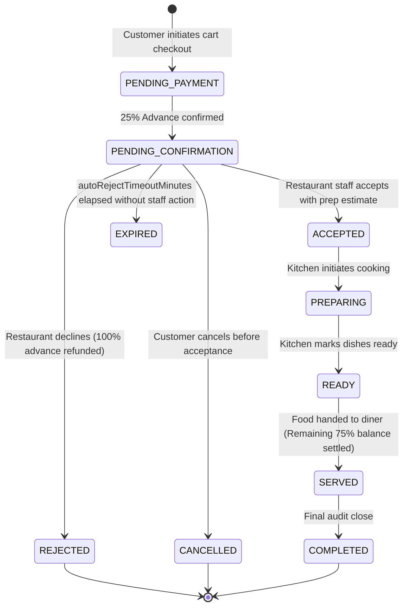

# Preplate — Order Lifecycle & Kitchen Operations Blueprint

**Version:** 1.0.0-PROD  
**Domain:** Pre-Arrival Kitchen Queue & Order State Machine  

---

## 1. Progressive Order State Machine

### Transition Enforcement Rules:
1. **No Backward Transitions:** An order cannot transition backward (e.g. from `PREPARING` to `ACCEPTED`).
2. **Terminal States:** `REJECTED`, `CANCELLED`, and `COMPLETED` are terminal. No further state changes are permitted.
3. **Actor Auditing:** Every transition writes an immutable record to `OrderStatusHistory` storing `{ orderId, orderReference, tenantId, previousStatus, newStatus, actor, reason, timestamp }`.

---

## 2. Arrival Scheduling & Preparation Buffer Enforcement

To ensure food is hot, fresh, and never sitting under heat lamps, orders enforce arrival window constraints:

1. **Future Arrival Check:** The expected arrival timestamp must be in the future:
   $$\text{expectedArrivalTime} > \text{now}$$
2. **Preparation Buffer (`orderBufferMinutes`):** The diner must select an arrival time at least $N$ minutes in advance (default: 20 minutes) to allow adequate kitchen prep time:
   $$\text{expectedArrivalTime} \ge \text{now} + (\text{orderBufferMinutes} - 1) \times 60 \times 1000$$
3. **Operating Hours Validation:** The arrival timestamp must fall within the restaurant's scheduled operating hours for that day of the week.

---

## 3. Inventory Portions & Automatic 86-ing

For items with `trackInventory: true`:
1. **Portion Decrement:** Upon successful order submission, `availableQuantity` decrements by `quantity`.
2. **Auto-86ing:** When `availableQuantity` drops to 0, `isAvailable` automatically switches to `false` (Sold Out).
3. **Cancellation Rollback:** If an order is rejected or cancelled before preparation, portions are automatically restored to inventory, and `isAvailable` is re-enabled if portions become $> 0$.
