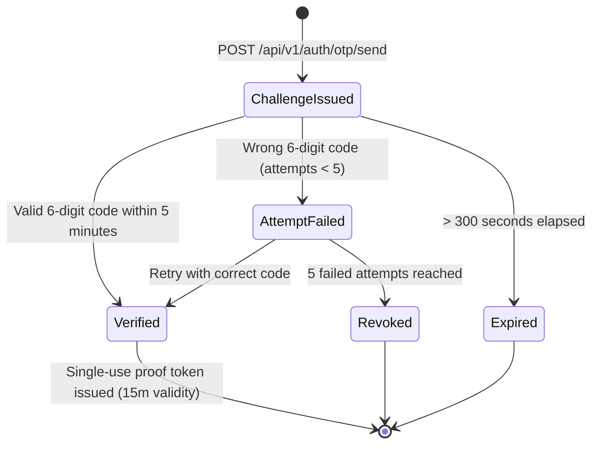

# Preplate — OTP Authentication Subsystem & Verification Specification

**Version:** 1.0.0-PROD  
**Pattern:** Keyed HMAC-SHA256 Challenge-Response Verification  
**Security Standard:** OWASP Mobile & Authentication Guidelines Aligned  

---

## 1. Overview & Architectural Purpose

One-Time Passwords (OTP) in Preplate confirm that a user controls the physical phone number they submit. OTP does not by itself confer tenant ownership or grant authorization; it serves as a cryptographic verification prerequisite for two strictly isolated workflows:

1. **Flow A: Restaurant Owner Registration** — Verifies the business contact phone number before an onboarding request is completed.
2. **Flow B: Customer Pre-Arrival Checkout** — Verifies a guest diner's phone number before reserving kitchen inventory portions.

### Strict Flow Isolation Guarantee:
A challenge created under `CUSTOMER_CHECKOUT` **cannot** be verified under `RESTAURANT_REGISTRATION`, and vice versa. Cross-flow reuse is rejected at the cryptographic schema layer.

---

## 2. Challenge Lifecycle & State Machine



---

## 3. Cryptographic Storage & Security Measures

### 3.1. Zero Plaintext Storage
- Plaintext OTP codes are **never** persisted to the database.
- The server computes a keyed HMAC hash:
  $$\text{hmacHash} = \text{HMAC-SHA256}(\text{code}, \text{OTP\_HMAC\_SECRET})$$
- Only `hmacHash`, `challengeId`, `phone`, `purpose`, and `expiresAt` are stored in the `otp_challenges` collection.

### 3.2. Timing-Safe Comparison
Verification uses `crypto.timingSafeEqual` between the stored HMAC buffer and the HMAC of the candidate code, preventing side-channel timing attacks.

### 3.3. Throttling, Cooldown & Abuse Protection
| Parameter | Value | Enforcement Mechanism |
| :--- | :--- | :--- |
| **Code Format** | 6 numeric digits (`100000` - `999999`) | `crypto.randomInt(100000, 999999)` |
| **Expiration (TTL)** | 300 seconds (5 minutes) | MongoDB TTL Index on `expiresAt` |
| **Resend Cooldown** | 60 seconds | Checked against `resendAfter` date; returns HTTP 429 |
| **Maximum Attempts** | 5 failed guesses | Challenge auto-revoked when `attempts >= maxAttempts` |
| **Single-Use Guard** | Atomic `isConsumed = true` | Prevents replay of verified challenges |
| **Proof Token Expiry** | 15 minutes | HMAC-signed JWT token binding phone and purpose |

---

## 4. API Endpoints Specification

### 4.1. Request Verification Code
`POST /api/v1/auth/otp/send`
- **Rate Limit:** 10 requests / 15 minutes per IP
- **Request Body:**
```json
{
  "phone": "+919811122233",
  "purpose": "RESTAURANT_REGISTRATION"
}
```
- **Response (200 OK):**
```json
{
  "success": true,
  "message": "Verification code sent to +919811122233",
  "data": {
    "challengeId": "3fa85f64-5717-4562-b3fc-2c963f66afa6",
    "phone": "+919811122233",
    "purpose": "RESTAURANT_REGISTRATION",
    "expiresInSeconds": 300,
    "cooldownSeconds": 60
  }
}
```

### 4.2. Verify Code & Receive Proof Token
`POST /api/v1/auth/otp/verify`
- **Request Body:**
```json
{
  "challengeId": "3fa85f64-5717-4562-b3fc-2c963f66afa6",
  "phone": "+919811122233",
  "code": "776137",
  "purpose": "RESTAURANT_REGISTRATION"
}
```
- **Response (200 OK):**
```json
{
  "success": true,
  "message": "Phone number verified successfully.",
  "data": {
    "verificationToken": "eyJhbGciOi..."
  }
}
```

---

## 5. Automated Verification & Testing Coverage

Tested and verified in [`server/src/tests/otpAndAdvancePayment.test.ts`](file:///c:/Restaurant/server/src/tests/otpAndAdvancePayment.test.ts):
- Code dispatch with HMAC hashing (test 1)
- 60-second cooldown enforcement (test 2)
- Rejection of invalid codes and attempt decrement (test 3)
- Rejection of mismatched purposes (test 4)
- Verification token issuance and challenge consumption (test 5)
- Replay prevention on consumed challenges (test 6)
- Owner onboarding with verification token binding (test 7)
- Customer checkout with verification token binding (test 8 & 9)
