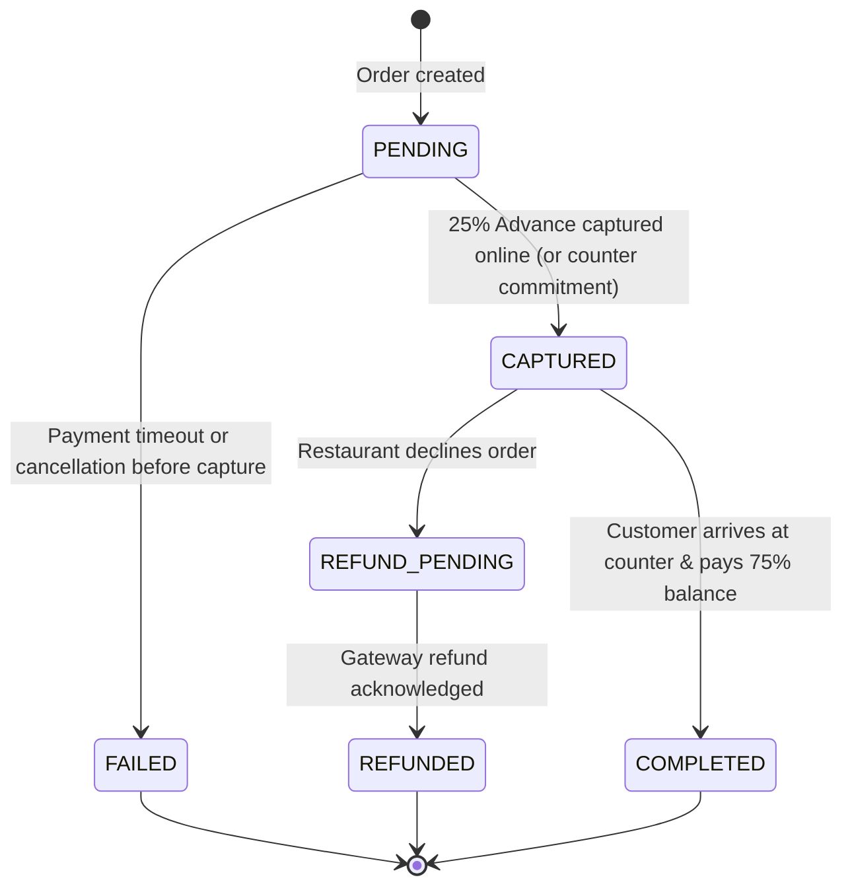

# Preplate — Payment Lifecycle & 25% Advance Specification

**Version:** 1.0.0-PROD  
**Policy Standard:** Minimum 25% Advance Pre-Payment  
**Default Currency:** INR (Represented as Integer Rupee / Smallest Currency Unit)  

---

## 1. Business Logic & 25% Advance Formulation

To prevent kitchen food waste and reservation hoarding from no-show diners who abandon orders, Preplate enforces an authoritative server-calculated minimum advance deposit:

$$\text{Subtotal} = \sum (\text{item.price} \times \text{quantity})$$
$$\text{Tax (GST 5\%)} = \text{round}(\text{Subtotal} \times 0.05)$$
$$\text{Total Amount} = \text{Subtotal} + \text{Tax}$$
$$\text{Required Advance} = \left\lceil \text{Total Amount} \times \frac{\text{Advance Percent}}{100} \right\rceil \quad (\text{Default: } 25\%)$$
$$\text{Remaining Balance} = \text{Total Amount} - \text{Captured Advance}$$

### Numerical Example:
- Subtotal (2x Dal Makhani): ₹440
- GST (5%): ₹22
- Total Payable: ₹462
- **Required Advance (25%):** $\lceil 462 \times 0.25 \rceil = \lceil 115.5 \rceil = \mathbf{₹116}$
- **Remaining Balance:** $462 - 116 = \mathbf{₹346}$ (Settled at counter upon diner arrival)

---

## 2. Payment State Machine & Order State Decoupling

Payment status is strictly independent from order fulfillment status:

### Relationship with Order Status:

| Order Status | Permitted Payment Statuses | Notes |
| :--- | :--- | :--- |
| `PENDING_CONFIRMATION` | `PENDING`, `CAPTURED` | Advance paid; awaiting kitchen review |
| `ACCEPTED` | `CAPTURED` | Kitchen confirmed prep; advance committed |
| `PREPARING` | `CAPTURED` | Food actively cooking |
| `READY` | `CAPTURED` | Plated and awaiting diner arrival |
| `SERVED` | `COMPLETED` | Handover completed; cashier collected balance |
| `REJECTED` | `REFUNDED`, `FAILED` | 100% advance refunded if restaurant declines |
| `CANCELLED` | `REFUNDED`, `FAILED` | Cancelled by diner before acceptance |

---

## 3. Fraud Prevention & Webhook Verification

1. **Zero Client Trust:** The client application never dictates payment success or payment amounts. The backend queries the payment gateway directly or processes cryptographically signed webhooks.
2. **Signed Webhooks:** For Razorpay integrations, every webhook payload is verified using HMAC-SHA256:
   $$\text{computedSignature} = \text{HMAC-SHA256}(\text{rawPayload}, \text{RAZORPAY\_WEBHOOK\_SECRET})$$
   Any mismatched signature is rejected with HTTP 400 Bad Request.
3. **Idempotency Keys:** Every payment attempt stores an idempotency reference, preventing duplicate double-deductions.

---

## 4. Refund Policy & 100% Guarantee Workflow

Preplate enforces a clear consumer protection guarantee:
- **Restaurant Decline Guarantee:** If the restaurant is unable to accept the order (e.g., sold out, kitchen rush, emergency closure), **100% of the advance payment is immediately marked for full refund**.
- **Customer Cancellation (Pre-Acceptance):** If the diner cancels while the order is still in `PENDING_CONFIRMATION`, the payment transitions to `REFUNDED`.
- **Post-Acceptance Changes:** Once the kitchen advances the order to `ACCEPTED` or `PREPARING`, food ingredients have been committed; cancellation requires direct restaurant coordination.
