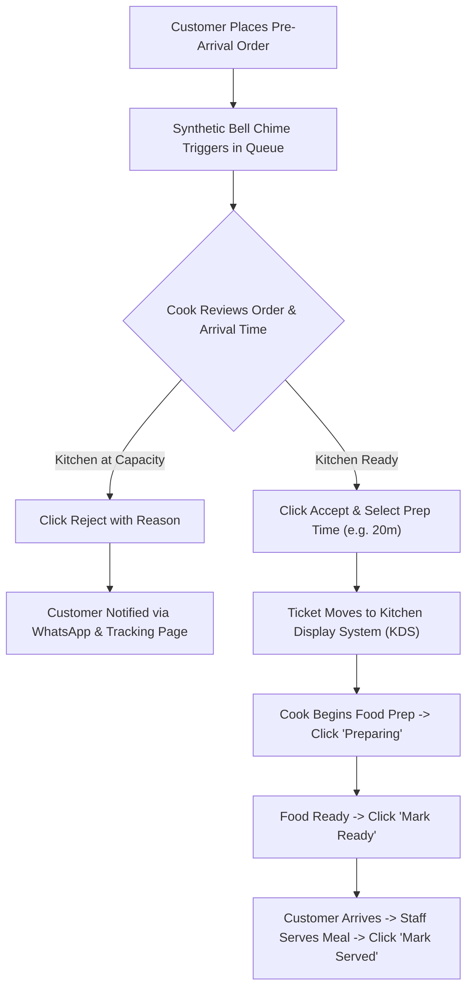

# Preplate — Pilot Operations Runbook & SOP

## 1. Pilot Mission & Hypotheses

Preplate is a multi-tenant B2B SaaS platform designed to coordinate pre-arrival food ordering between dine-in customers and restaurant kitchens.

### Target Validation Hypotheses:
1. **Wait-Time Reduction:** Pre-arrival ordering reduces customer table waiting time from an average of 25–35 minutes down to under 5–10 minutes.
2. **Acceptance Rate & Buffer Reliability:** Restaurants can achieve an order acceptance rate exceeding 90% when equipped with a 20-minute preparation buffer.
3. **Frictionless Communication:** Direct WhatsApp deep-links (`wa.me`) provide an immediate, zero-cost communication channel between guests and kitchens without requiring upfront Meta Cloud API approvals during the pilot stage.

---

## 2. Target Pilot Segments

- **Highway Express Dhabas & Restaurants:** Located on high-speed expressway corridors (e.g., Delhi-Jaipur NH 48, Mumbai-Pune Expressway) where travelers seek freshly prepared meals ready upon arrival.
- **Corporate Food Hubs & Office Parks:** Lunchtime crowds with rigid 45-minute lunch breaks.
- **University Campus Cafes:** High-volume transition periods between classes.

---

## 3. Pre-Pilot Restaurant Onboarding Checklist

| Step | Action | Verifiable Output |
|---|---|---|
| **1. Account Creation** | Register restaurant at `/register` | Tenant allocated, slug generated (e.g., `/r/highway-dhaba`) |
| **2. Operating Hours** | Configure weekly schedule in `/admin/restaurant` | `isOpenNow` calculation validates guest orders |
| **3. Preparation Buffers** | Set `orderBufferMinutes` (default: 20 mins) | Prevents last-minute impossible orders |
| **4. Menu Digitization** | Add categories & dishes with realistic prices (INR) | Public menu displays vegetarian/non-veg tags |
| **5. WhatsApp Dispatch** | Enter verified WhatsApp contact number | Click-to-Chat deep links direct to staff device |
| **6. Staff KDS Training** | Train kitchen cooks on touch-friendly KDS | Cooks can advance tickets with 1 touch |

---

## 4. Kitchen Staff Standard Operating Procedure (SOP)

### Critical Rules for Kitchen Staff:
1. **Never let an order sit in queue without action:** Accept or reject incoming orders within 3 minutes of receipt.
2. **Instant 86ing (Out-of-Stock):** If an ingredient runs out during a shift, immediately toggle the item off in `/admin/restaurant` (`Menu & Stock Availability`). Customers are blocked from ordering it instantaneously.
3. **Realistic Prep Time:** When accepting an order, select a prep duration matching kitchen workload (15, 20, 25, or 35 minutes). The customer tracking portal calculates `estimatedReadyTime` based on your input.

---

## 5. Customer Experience Journey

1. **Discovery:** Customer scans a roadside QR poster or clicks a promotional link (`preplate.app/r/highway-dhaba`).
2. **Menu Selection:** Customer selects dishes, views item prices (zero surprise fees), and reviews 5% GST breakdown.
3. **ETA Selection:** Customer specifies arrival time (validated against restaurant operating hours and prep buffer).
4. **Order Request Placement:** Order is persisted with `PENDING_CONFIRMATION` and reference `ORD-YYYYMMDD-XXXX`.
5. **WhatsApp Confirmation Link:** A prefilled WhatsApp message opens with the reference, items, and arrival time.
6. **Live Status Tracking:** Customer tracks live status progression (`PENDING_CONFIRMATION` → `ACCEPTED` → `PREPARING` → `READY` → `SERVED`) on mobile web.

---

## 6. Incident Management & Edge Cases

| Scenario | System Defense & Remediation |
|---|---|
| **Sudden Kitchen Rush** | Staff toggles out-of-stock items or temporarily suspends acceptance. Unaccepted orders auto-reject after 15 minutes. |
| **Customer Late by > 30 Mins** | Orders stay marked `READY`. Kitchen can reach out directly via the customer phone number listed on the ticket. |
| **Power or Internet Failure** | Preplate operates with pessimistic offline handling. Customers attempting to place orders will receive an error if the server cannot verify availability. |
| **Tenant Delinquency** | Platform Super Admin suspends the tenant from `/admin/super`. Operational endpoints immediately return `403 Forbidden` with an administrative notice. |

---

## 7. Pilot Success Metrics

At the end of a 30-day pilot across 5 partner restaurants, evaluate:
- **Order Acceptance Rate:** Target $\ge 92\%$
- **Average Customer Table Wait Time:** Target $\le 8$ minutes
- **Kitchen Staff Adherence:** Percentage of orders marked `READY` within 5 minutes of customer arrival.
- **Repeat Order Rate:** Percentage of guests who place a second pre-arrival order within 3 weeks.
